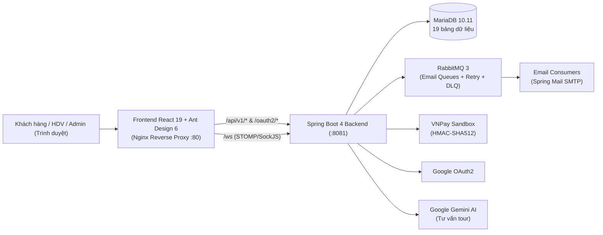

# ✈️ TravelHub — Hệ Thống Bán & Quản Lý Tour Du Lịch Trực Tuyến

> **Đồ Án Cuối Kỳ Môn Phát Triển Ứng Dụng J2EE**  
> Kiến trúc **Full-stack tách biệt Backend (Spring Boot) & Frontend (React)** tích hợp **Google OAuth2**, **VNPay Sandbox**, **Spring Mail + RabbitMQ (Retry & DLQ)**, **WebSocket Real-time**, **Gemini AI**, **Xuất Excel/PDF**, **Spring Test**, và **Docker + Nginx**.

---

## 1. Kiến trúc tổng quan



---

## 2. Tính năng nổi bật theo 3 nhóm quyền

### 👤 Khách hàng (`ROLE_CUSTOMER`)
- **Tìm kiếm & lọc tour đa tiêu chí** (từ khóa, điểm khởi hành, loại hình Nội địa/Quốc tế, danh mục, phân trang & đồng bộ URL).
- **Xem chi tiết tour đầy đủ:** Album ảnh, lịch khởi hành còn chỗ, lịch trình từng ngày, chính sách bao gồm/không bao gồm, đánh giá sao từ khách hàng.
- **Đặt tour thông minh:** Chọn điểm đón dọc đường, thêm nhiều hành khách (Người lớn/Trẻ em), áp dụng mã Voucher giảm giá, **tạm tính tổng tiền theo thời gian thực**, khóa ghế chống đặt trùng bằng `@Lock(PESSIMISTIC_WRITE)`.
- **Thanh toán trực tuyến VNPay:** Chuyển hướng cổng VNPay, xác thực chữ ký HMAC-SHA512, cập nhật trạng thái tức thì, **tải Vé điện tử & Hóa đơn PDF**.
- **Quản lý vé & Hủy tour:** Lọc theo trạng thái, xem chi tiết hành khách, yêu cầu hủy vé theo chính sách hoàn tiền tự động, nhận thông báo **real-time qua WebSocket** và **Email HTML** qua RabbitMQ.
- **Trợ lý Du lịch AI (Gemini):** Chat tư vấn gợi ý tour phù hợp dựa trên danh sách tour đang mở bán trong cơ sở dữ liệu.
- **Yêu cầu thiết kế Tour Khách Đoàn (B2B):** Gửi yêu cầu thiết kế riêng cho doanh nghiệp/đoàn thể.
- **Đăng nhập linh hoạt:** Tài khoản Email/Mật khẩu (JWT) hoặc **Google OAuth2 (Gmail)**.

### 🧭 Hướng dẫn viên (`ROLE_GUIDE`)
- **Cổng tác nghiệp hiện trường (`/guide`):** Xem lịch phân công chuyến đi (tự động ưu tiên chuyến sắp khởi hành gần nhất lên đầu).
- **Điểm danh hành khách theo lộ trình xe đón:** Danh sách hành khách tự động gom theo **giờ xe đón (`pickupTime ASC`)** và **mã đơn**, theo dõi tiến độ lên xe bằng thanh progress, gọi điện trực tiếp cho trưởng nhóm.
- **Xuất Excel danh sách đoàn (Manifest):** Tải file `.xlsx` nhanh chóng cho từng chuyến đi.

### 🛡️ Quản trị viên (`ROLE_ADMIN`)
- **Dashboard thống kê doanh thu:** 4 chỉ số KPI, biểu đồ doanh thu 12 tháng, Top 5 tour bán chạy, phân bổ trạng thái đơn hàng, **xuất Báo cáo Tài chính tháng ra Excel (.xlsx)**.
- **Quản trị toàn diện 12 phân hệ:** Tour du lịch (kèm Album ảnh & Chính sách), Danh mục, Lịch khởi hành (kèm Điểm đón xe & Phân công HDV ưu tiên Trưởng đoàn), Lịch trình từng ngày, Khuyến mãi/Voucher, Đơn đặt tour, Xử lý hủy & hoàn tiền (tự động bắn email biên lai qua RabbitMQ), Lịch sử thanh toán (kèm ghi nhận thanh toán tại quầy), Yêu cầu Tour đoàn B2B, Người dùng & Phân quyền, Kiểm duyệt Đánh giá.
- **Tác vụ tự động (`@Scheduled`):** Tự động hủy đơn chưa thanh toán quá 15 phút & hoàn lại ghế trống; tự động đóng các đợt khởi hành đã qua ngày đi lúc `00:00` hằng ngày.

---

## 3. Công nghệ sử dụng

| Lớp | Công nghệ |
| :--- | :--- |
| **Backend** | Java 17, Spring Boot 4.1.1, Spring Data JPA (Hibernate), Spring Security (JWT + OAuth2 Client), Spring Validation, Spring Mail, Spring AMQP (RabbitMQ), Spring WebSocket (STOMP/SockJS), SpringDoc OpenAPI (Swagger UI) |
| **Frontend** | React 19, Vite 8, Ant Design 6, React Router 7, Axios, SockJS & STOMP, thiết kế theo nguyên tắc **C.R.A.P.** |
| **Cơ sở dữ liệu & Queue** | MariaDB 10.11 / MySQL 8, RabbitMQ 3 (Management + Retry + Dead Letter Queue) |
| **Tích hợp & Báo cáo** | VNPay Payment Gateway (v2.1.0), Google OAuth2, Google Gemini AI, Apache POI 5.2.5 (Excel), OpenPDF 1.3.39 (PDF) |
| **Kiểm thử & DevOps** | JUnit 5, Mockito, Spring Test Pyramid (**18 bộ test / 60 test cases PASS 100%** trên H2 độc lập: 70% Unit – 20% Slice – 10% Integration), Docker Multi-stage Build, Docker Compose, Nginx |

---

## 4. Cấu trúc thư mục dự án

```text
Travel_Tour_System/
├── backend/                        # Dự án Spring Boot REST API
│   ├── pom.xml
│   └── src/
│       ├── main/java/com/travelhub/
│       │   ├── config/             # Security, CORS, RabbitMQ, VNPay, WebSocket, Web
│       │   ├── consumer/           # RabbitMQ Consumers (BookingEmail, RefundEmail)
│       │   ├── controller/         # admin/ (16), client/ (9), common/ (4), guide/ (1)
│       │   ├── dto/                # Chia 5 gói chuẩn: common/, filter/, message/, request/, response/
│       │   ├── entity/             # 18 JPA Entities + BaseEntity (19 bảng DB)
│       │   ├── enums/              # 16 Enum nghiệp vụ
│       │   ├── exception/          # GlobalExceptionHandler
│       │   ├── repository/         # 18 Spring Data JPA Repositories
│       │   ├── scheduler/          # BookingScheduler (@Scheduled)
│       │   ├── security/           # JWT Filter, JwtUtils, OAuth2 SuccessHandler
│       │   └── service/            # Service Interfaces & impl/ (24 Implementations)
│       └── test/
│           ├── resources/
│           │   └── application-test.properties  # Cấu hình H2 In-Memory DB chạy test độc lập
│           └── java/com/travelhub/              # Kiến trúc Testing Pyramid (60/60 PASS)
│               ├── unit/domain/                 # 3 Domain/Util Unit Tests (13 tests - 21.7%)
│               ├── unit/service/                # 8 Service Mockito Unit Tests (29 tests - 48.3%)
│               ├── slice/repository/            # 2 @DataJpaTest Slice Tests (6 tests - 10%)
│               ├── slice/controller/            # 2 @WebMvcTest Slice Tests (6 tests - 10%)
│               └── integration/                 # 3 @SpringBootTest Integration Tests (6 tests - 10%)
├── frontend/                       # Dự án React + Vite + Ant Design
│   ├── Dockerfile
│   ├── nginx.conf                  # Reverse Proxy cho /api/v1, /ws, /oauth2
│   └── src/
│       ├── api/                    # axiosClient (tự nhận diện localhost / production)
│       ├── components/             # Layouts (Client, Guide, Admin), Modals, AI Chat, Notification
│       ├── context/                # AuthContext
│       ├── pages/                  # 12 trang Admin + pages/client/ (6 trang Customer + 1 Guide)
│       └── services/               # 18 API Service modules
├── docs/
│   └── BAO_CAO_DO_AN_CUOI_KY.md    # Báo cáo đồ án cuối kỳ đầy đủ
├── docker-compose.yml              # Chạy trọn bộ 4 container: DB, RabbitMQ, Backend, Frontend
├── Dockerfile.backend              # Multi-stage Maven + Temurin JRE 17
├── seed_real_data_travelhub.sql    # Dữ liệu mẫu 12 tour thực tế + danh mục + lịch khởi hành
└── .env.example                    # File mẫu biến môi trường (copy thành .env trước khi chạy)
```

---

## 5. Hướng dẫn cài đặt & chạy dự án

### Bước 1: Tạo file biến môi trường `.env`
Copy file mẫu `.env.example` thành `.env` tại thư mục gốc dự án rồi điền các thông số của bạn:

```bash
cp .env.example .env
```

Các biến chính trong `.env`:
- `JWT_SECRET`: Khóa ký JWT (tối thiểu 32 ký tự).
- `MAIL_USERNAME`, `MAIL_PASSWORD`: Gmail & App Password gửi email xác nhận.
- `GOOGLE_CLIENT_ID`, `GOOGLE_CLIENT_SECRET`, `OAUTH2_REDIRECT_URI`: Cấu hình Google OAuth2.
- `GEMINI_API_KEY`, `GEMINI_API_URL`: Khóa API Google Gemini cho Trợ lý tư vấn tour.
- `VNPAY_TMN_CODE`, `VNPAY_HASH_SECRET`, `VNPAY_RETURN_URL`: Cấu hình VNPay Sandbox.

---

### Cách A: Chạy toàn bộ hệ thống bằng Docker Compose (Khuyên dùng)

Yêu cầu máy đã cài **Docker Desktop**:

```bash
docker compose up -d --build
```

Sau khi khởi động xong:
- **Website (Customer / Guide / Admin):** `http://localhost`
- **Backend API & Swagger UI:** `http://localhost:8081/swagger-ui/index.html`
- **RabbitMQ Management Dashboard:** `http://localhost:15672` (`guest` / `guest`)
- **Nạp dữ liệu tour mẫu:** Import file `seed_real_data_travelhub.sql` vào database `travel_enterprise_db`.

---

### Cách B: Chạy phát triển cục bộ (Local Development)

1. **Chuẩn bị hạ tầng:** Khởi động MySQL/MariaDB (cổng `3306`, tạo database `travel_enterprise_db`) và RabbitMQ (cổng `5672`).
2. **Chạy Backend (Spring Boot — cổng `8081`):**
   ```bash
   cd backend
   ./mvnw spring-boot:run
   ```
   *(Spring Boot tự động đọc file `.env` ở thư mục gốc nhờ `spring.config.import` trong `application.properties`.)*
3. **Nạp dữ liệu mẫu:** Chạy file `seed_real_data_travelhub.sql` trong phpMyAdmin / MySQL Workbench / HeidiSQL.
4. **Chạy Frontend (React Vite — cổng `5173`):**
   ```bash
   cd frontend
   npm install
   npm run dev
   ```
   Mở trình duyệt tại `http://localhost:5173`.

---

## 6. Kiểm thử (Spring Test & Thanh toán VNPay Sandbox)

### Chạy bộ Unit Test
```bash
cd backend
./mvnw test
```

### Thẻ test ngân hàng NCB trên VNPay Sandbox
Khi test thanh toán trực tuyến VNPay ở trang **Vé của tôi (`/my-bookings`)**, chọn ngân hàng **NCB** và nhập thông tin giả lập chính thức từ VNPay:

| Thông tin | Giá trị |
| :--- | :--- |
| **Ngân hàng** | `NCB` |
| **Số thẻ** | `9704198526191432198` |
| **Tên chủ thẻ** | `NGUYEN VAN A` |
| **Ngày phát hành** | `07/15` |
| **Mã OTP** | `123456` |

---

## 7. Tài liệu báo cáo

Toàn bộ báo cáo phân tích, thiết kế CSDL, sơ đồ luồng nghiệp vụ, kiến trúc Spring Test Pyramid và đánh giá hệ thống nằm tại:  
📄 [`docs/BAO_CAO_DO_AN_CUOI_KY.md`](docs/BAO_CAO_DO_AN_CUOI_KY.md) · 📕 [`docs/BAO_CAO_DO_AN_CUOI_KY.pdf`](docs/BAO_CAO_DO_AN_CUOI_KY.pdf)
