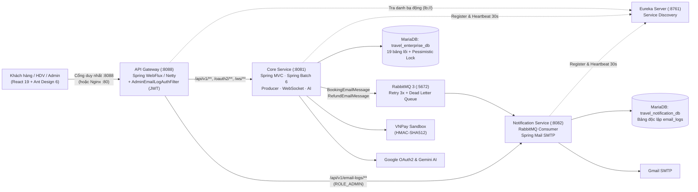

# ✈️ TravelHub — Hệ Thống Bán & Quản Lý Tour Du Lịch Trực Tuyến

> **Đồ Án Cuối Kỳ Học Phần Chuyên Đề J2EE (Mã HP: `841468` — Nhóm `01` — 4 TC)**  
> **Sinh viên thực hiện:** Nguyễn Lê Quân Anh (MSSV: `3123411016`) — Khoa Công nghệ Thông tin, Trường Đại học Sài Gòn (SGU)  
> Kiến trúc **Spring Cloud Microservices (4 dịch vụ)** tách độc lập với **Frontend SPA (React 19 + Ant Design 6)**, tích hợp **Netflix Eureka**, **Spring Cloud Gateway (WebFlux/Netty + JWT GlobalFilter)**, **Database per Service**, **Google OAuth2**, **VNPay Sandbox (HMAC-SHA512)**, **RabbitMQ (Retry 3x & DLQ)**, **Spring Batch 6 (Import CSV Chunk)**, **WebSocket Real-time**, **Google Gemini AI**, **Xuất Excel/PDF**, **Spring Test Pyramid (65/65 PASS)** và **Docker Compose (7 containers)**.

---

## 1. Kiến trúc tổng quan (Spring Cloud Microservices)



---

## 2. Tính năng nổi bật theo 3 nhóm quyền (20 màn hình chuẩn C.R.A.P.)

### 👤 Khách hàng (`ROLE_CUSTOMER` — 6 màn hình)
- **Tìm kiếm & lọc tour đa tiêu chí** (từ khóa, điểm khởi hành, loại hình Nội địa/Quốc tế, danh mục, phân trang & đồng bộ URL).
- **Xem chi tiết tour đầy đủ:** Album ảnh, lịch khởi hành còn chỗ, lịch trình từng ngày, chính sách bao gồm/không bao gồm, đánh giá sao từ khách hàng.
- **Đặt tour thông minh:** Chọn điểm đón dọc đường (hoặc chọn **tự túc tập trung tại điểm khởi hành**), thêm nhiều hành khách (Người lớn/Trẻ em), áp dụng mã Voucher giảm giá, **tạm tính tổng tiền theo thời gian thực**, khóa ghế chống bán vượt chỗ bằng `@Lock(PESSIMISTIC_WRITE)`.
- **Thanh toán trực tuyến VNPay:** Chuyển hướng cổng VNPay v2.1.0, xác thực chữ ký HMAC-SHA512, cập nhật trạng thái tức thì, **tải Vé điện tử & Hóa đơn PDF tiếng Việt**.
- **Quản lý vé & Hủy tour:** Lọc theo trạng thái, xem chi tiết hành khách, yêu cầu hủy vé theo chính sách hoàn tiền tự động (0% / 30% / 70% / 100%), nhận thông báo **real-time qua WebSocket** và **Email HTML** từ `notification-service`.
- **Trợ lý Du lịch AI (Gemini):** Chat tư vấn gợi ý tour phù hợp bằng kỹ thuật *Context Injection* từ danh sách tour đang mở bán.
- **Yêu cầu thiết kế Tour Khách Đoàn (B2B)** & **Đăng nhập linh hoạt** (Email/Mật khẩu JWT hoặc **Google OAuth2**).

### 🧭 Hướng dẫn viên (`ROLE_GUIDE` — 1 cổng chuyên dụng)
- **Cổng tác nghiệp hiện trường (`/guide`):** Xem lịch phân công chuyến đi (tự động ưu tiên chuyến sắp khởi hành gần nhất lên đầu).
- **Điểm danh hành khách theo lộ trình xe đón:** Danh sách hành khách tự động sắp xếp theo **giờ xe đón (`pickupTime ASC`)** và **mã đơn** (khách tự túc xếp cuối), theo dõi tiến độ lên xe và gọi nhanh trưởng nhóm.
- **Xuất Excel danh sách đoàn (Manifest):** Tải file `.xlsx` nhanh chóng cho từng chuyến đi.

### 🛡️ Quản trị viên (`ROLE_ADMIN` — 13 màn hình)
- **Dashboard thống kê doanh thu:** 4 chỉ số KPI, biểu đồ doanh thu 12 tháng, Top 5 tour bán chạy, phân bổ trạng thái đơn hàng, **xuất Báo cáo Tài chính tháng ra Excel (`.xlsx`)**.
- **Nhập Lịch khởi hành hàng loạt bằng Spring Batch 6 (`/admin/departures`):** Tải file CSV mẫu, kéo-thả file CSV để xử lý theo lô (`chunk = 10`), tự động tính `returnDate = departureDate + durationDays - 1`, bỏ qua dòng lỗi (*Skip Policy*) và hiển thị báo cáo Đọc / Thành công / Bỏ qua chi tiết.
- **Nhật ký gửi Email (`/admin/email-logs`):** Tra cứu trực tiếp lịch sử gửi mail (`SENT` / `FAILED`) từ **`notification-service` (`travel_notification_db`)** qua **API Gateway** có chốt chặn JWT `ROLE_ADMIN` (`401` / `403` / `200`).
- **Quản trị toàn diện các phân hệ lõi:** Tour (Album ảnh & Chính sách), Danh mục, Lịch khởi hành (Điểm đón & Phân công HDV), Lịch trình ngày, Khuyến mãi/Voucher, Đơn đặt tour, Xử lý hủy & hoàn tiền, Thanh toán, Yêu cầu Tour đoàn B2B, Người dùng & Phân quyền, Kiểm duyệt Đánh giá.
- **Tác vụ tự động (`@Scheduled`):** Tự động hủy đơn chưa thanh toán quá 15 phút & hoàn lại ghế trống; tự động đóng các đợt khởi hành đã qua ngày đi lúc `00:00` hằng ngày.

---

## 3. Công nghệ sử dụng (Ứng dụng 6/11 công nghệ Seminar)

| Lớp | Công nghệ & Phiên bản |
| :--- | :--- |
| **Microservices & Gateway** | **Spring Cloud `2025.1.4` (Oakwood)**, **Netflix Eureka Server** (`:8761`), **Spring Cloud Gateway WebFlux/Netty** (`:8088`), Load Balancing động `lb://`, WebFlux `GlobalFilter` (`AdminEmailLogAuthFilter`) |
| **Backend Core & Batch** | Java 17, **Spring Boot `4.1.1`**, Spring WebMVC, Spring Data JPA (Hibernate), Spring Security (JWT + OAuth2 Client), **Spring Batch `6.0.5`** (Chunk + Skip Policy), Spring Validation, SpringDoc OpenAPI |
| **Notification & Messaging** | **`notification-service` (`:8082`)** độc lập, **RabbitMQ 3** (AMQP + Retry 3x + Dead Letter Queue), Spring Mail SMTP, Spring WebSocket (STOMP/SockJS) |
| **Cơ sở dữ liệu** | **Database per Service (MariaDB 10.11 / MySQL 8):** `travel_enterprise_db` (19 bảng lõi) & `travel_notification_db` (bảng `email_logs`), H2 In-Memory DB (Test) |
| **Tích hợp & Chứng từ** | VNPay Payment Gateway v2.1.0 (HMAC-SHA512), Google OAuth2, Google Gemini AI, Apache POI 5.2.5 (Excel), OpenPDF 1.3.39 (PDF tiếng Việt) |
| **Frontend SPA** | React 19, Vite 8, Ant Design 6, React Router 7, Axios, SockJS & STOMP — 20 màn hình chuẩn **C.R.A.P.** |
| **Kiểm thử & DevOps** | JUnit 5, Mockito, **Spring Test Pyramid (20 lớp / 65 test cases PASS 100%)**, Multi-stage Docker, **Docker Compose (7 containers)**, Nginx Reverse Proxy |

---

## 4. Cấu trúc Monorepo dự án

```text
Travel_Tour_System/
├── backend/
│   ├── eureka-server/              # [Port 8761] Netflix Eureka Service Discovery
│   ├── api-gateway/                # [Port 8088] Spring Cloud Gateway (WebFlux/Netty)
│   │   └── src/main/
│   │       ├── java/com/travelhub/gateway/filter/AdminEmailLogAuthFilter.java
│   │       └── resources/application.yml
│   ├── core-service/               # [Port 8081] Nghiệp vụ lõi + Producer + Spring Batch 6
│   │   └── src/
│   │       ├── main/java/com/travelhub/
│   │       │   ├── batch/          # Spring Batch 6 CSV Reader/Processor/Writer/Config
│   │       │   ├── config/         # Security, CORS, RabbitMQ, VNPay, WebSocket, JPA Auditing
│   │       │   ├── controller/     # admin/ (17), client/ (9), common/ (4), guide/ (1)
│   │       │   ├── dto/            # 5 gói chuẩn: common/, filter/, message/, request/, response/
│   │       │   ├── entity/         # 18 JPA Entities + BaseEntity (19 bảng travel_enterprise_db)
│   │       │   ├── repository/     # 18 Repositories (Pessimistic Lock + JPQL)
│   │       │   ├── scheduler/      # BookingScheduler (@Scheduled)
│   │       │   ├── security/       # JwtAuthenticationFilter, JwtUtils, OAuth2 SuccessHandler
│   │       │   └── service/impl/   # Business Services + BatchImportServiceImpl
│   │       └── test/java/com/travelhub/  # Testing Pyramid — 20 lớp / 65/65 PASS trên H2
│   │           ├── unit/domain/          # 3 lớp (13 tests — 20.0%)
│   │           ├── unit/service/         # 9 lớp (33 tests — 50.8%, gồm DepartureItemProcessor)
│   │           ├── slice/repository/     # 2 lớp @DataJpaTest (6 tests — 9.2%)
│   │           ├── slice/controller/     # 2 lớp @WebMvcTest (6 tests — 9.2%)
│   │           └── integration/          # 4 lớp @SpringBootTest (7 tests — 10.8%, gồm Spring Batch)
│   └── notification-service/       # [Port 8082] Microservice gửi Email độc lập
│       └── src/main/java/com/travelhub/
│           ├── config/             # RabbitMQConfig (Queues + Retry + DLQ)
│           ├── consumer/           # BookingEmailConsumer, RefundEmailConsumer
│           ├── controller/         # EmailLogController (GET /api/v1/email-logs)
│           ├── dto/message/        # BookingEmailMessage, RefundEmailMessage (khớp __TypeId__)
│           ├── entity/             # EmailLog (DB riêng travel_notification_db)
│           ├── repository/         # EmailLogRepository
│           └── service/impl/       # EmailServiceImpl (Gmail SMTP + ghi log SENT/FAILED)
├── frontend/                       # [Port 5173 / Nginx 80] React 19 + Vite 8 + Ant Design 6
│   ├── Dockerfile
│   ├── nginx.conf                  # Reverse Proxy /api/v1, /ws, /oauth2 -> api-gateway:8088
│   └── src/
│       ├── api/                    # axiosClient (gọi duy nhất API Gateway :8088)
│       ├── components/             # ClientLayout, GuideLayout, AdminLayout, Modals, AI, WS
│       ├── pages/                  # 13 trang Admin (gồm EmailLogManagement) + 7 trang Client/Guide
│       └── services/               # API Service modules (gồm Batch Import CSV)
├── docs/
│   ├── BAO_CAO_DO_AN_CUOI_KY.pdf   # Báo cáo đồ án cuối kỳ chuẩn Khoa CNTT SGU (26 trang A4)
│   ├── BAO_CAO_DO_AN_CUOI_KY.md    # Bản Markdown báo cáo
│   └── images/HUONG_DAN_CHUP_ANH.md
├── docker-compose.yml              # Điều phối trọn bộ 7 container
├── Dockerfile.backend              # Multi-stage Maven 3.9 + Temurin JRE 17 (dùng chung 4 MS)
├── seed_real_data_travelhub.sql    # Dữ liệu mẫu 12 tour thực tế + danh mục + lịch khởi hành
└── .env.example                    # File mẫu biến môi trường (copy thành .env trước khi chạy)
```

---

## 5. Hướng dẫn cài đặt & chạy hệ thống

### Bước 1: Tạo file biến môi trường `.env`
Copy `.env.example` thành `.env` tại thư mục gốc `Travel_Tour_System/` (cả `core-service`, `notification-service` và `api-gateway` đều tự nạp chung 1 file `.env` này):

```bash
cp .env.example .env
```

Các biến chính: `JWT_SECRET` (≥ 32 ký tự), `MAIL_USERNAME`, `MAIL_PASSWORD`, `GOOGLE_CLIENT_ID`, `GOOGLE_CLIENT_SECRET`, `GEMINI_API_KEY`, `VNPAY_TMN_CODE`, `VNPAY_HASH_SECRET`.

---

### Cách A: Chạy trọn bộ 7 container bằng Docker Compose (1 lệnh duy nhất)

```bash
docker compose up -d --build
```

Sau khi khởi động xong:
- **Website (Customer / Guide / Admin):** `http://localhost`
- **Eureka Dashboard:** `http://localhost:8761`
- **API Gateway:** `http://localhost:8088`
- **Swagger UI (`core-service`):** `http://localhost:8088/swagger-ui/index.html`
- **RabbitMQ Management:** `http://localhost:15672` (`guest` / `guest`)

---

### Cách B: Chạy phát triển cục bộ (Local Development)

1. Bật **MariaDB/MySQL** (cổng `3306`, tạo 2 DB: `travel_enterprise_db` và `travel_notification_db`) và **RabbitMQ** (cổng `5672`).
2. Khởi động lần lượt theo thứ tự (**luôn bật Eureka trước ~10 giây**):
   ```powershell
   # Terminal 1 — Eureka Server (:8761)
   cd backend/eureka-server && .\mvnw.cmd spring-boot:run

   # Terminal 2 — Core Service (:8081)
   cd backend/core-service && .\mvnw.cmd spring-boot:run

   # Terminal 3 — Notification Service (:8082)
   cd backend/notification-service && .\mvnw.cmd spring-boot:run

   # Terminal 4 — API Gateway (:8088)
   cd backend/api-gateway && .\mvnw.cmd spring-boot:run

   # Terminal 5 — Frontend React (:5173)
   cd frontend && npm install && npm run dev
   ```
   Truy cập Web tại `http://localhost:5173` và kiểm tra 3 dịch vụ xanh `UP` tại `http://localhost:8761`.

---

## 6. Kiểm thử tự động (Spring Test) & VNPay Sandbox

### Chạy trọn bộ 65 Spring Tests (không cần MySQL / Eureka / RabbitMQ)
```powershell
cd backend/core-service
.\mvnw.cmd test
```
Kết quả kỳ vọng: **`Tests run: 65, Failures: 0, Errors: 0, Skipped: 0 — BUILD SUCCESS`**.

### Thẻ test ngân hàng NCB trên VNPay Sandbox
| Thông tin | Giá trị |
| :--- | :--- |
| **Ngân hàng** | `NCB` |
| **Số thẻ** | `9704198526191432198` |
| **Tên chủ thẻ** | `NGUYEN VAN A` |
| **Ngày phát hành** | `07/15` |
| **Mã OTP** | `123456` |

---

## 7. Tài liệu báo cáo

📕 **Báo cáo đồ án chuẩn Khoa CNTT — ĐH Sài Gòn (26 trang A4):** [`docs/BAO_CAO_DO_AN_CUOI_KY.pdf`](docs/BAO_CAO_DO_AN_CUOI_KY.pdf)  
📄 **Bản Markdown:** [`docs/BAO_CAO_DO_AN_CUOI_KY.md`](docs/BAO_CAO_DO_AN_CUOI_KY.md)
