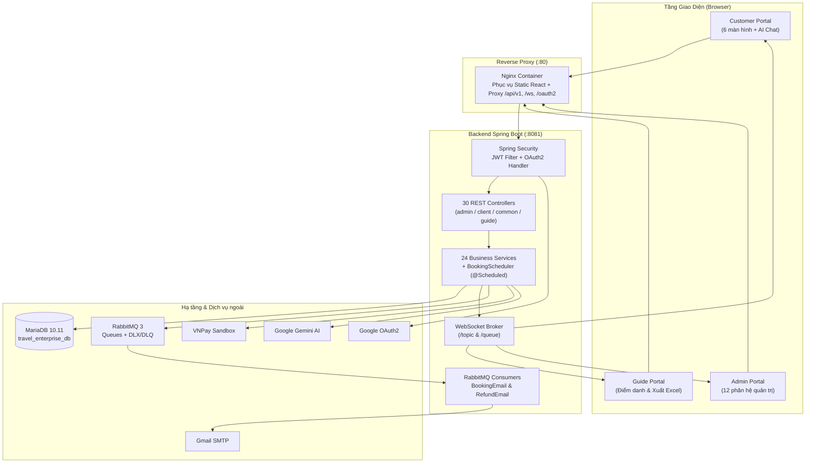
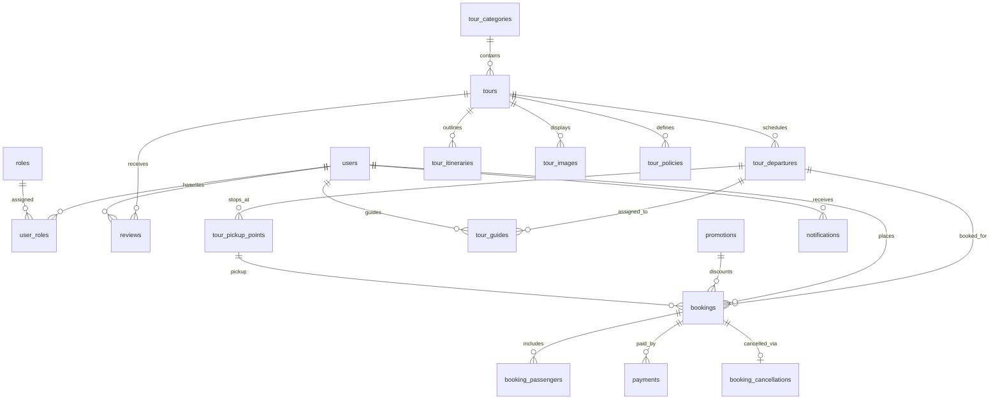
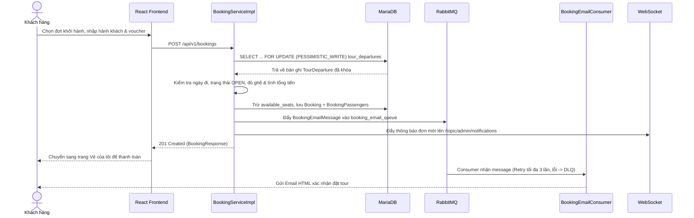
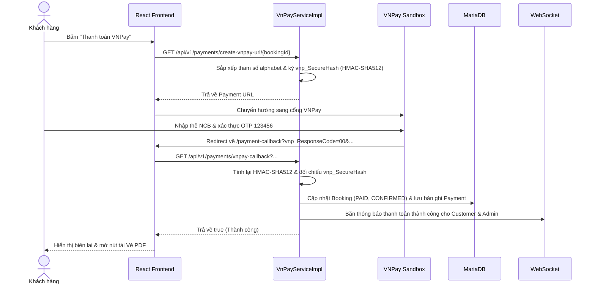
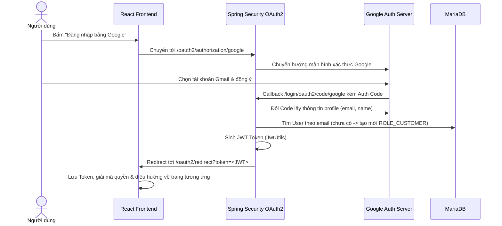

# BÁO CÁO ĐỒ ÁN MÔN HỌC — CHUYÊN ĐỀ J2EE (841468)

**ỦY BAN NHÂN DÂN THÀNH PHỐ HỒ CHÍ MINH**  
**TRƯỜNG ĐẠI HỌC SÀI GÒN**  
**KHOA CÔNG NGHỆ THÔNG TIN**

---

# ĐỀ TÀI: XÂY DỰNG HỆ THỐNG BÁN VÀ QUẢN LÝ TOUR DU LỊCH TRỰC TUYẾN (TRAVELHUB)

**Học phần:** Chuyên đề J2EE (`841468` — Nhóm `01` — `4` Tín chỉ)  
**Giảng viên hướng dẫn:** .........................................................  
**Sinh viên thực hiện:** Nguyễn Lê Quân Anh  
**Mã số sinh viên:** `3123411016`  
**Năm học:** 2025 – 2026

---

## LỜI NÓI ĐẦU

Trong bối cảnh ngành du lịch chuyển dịch mạnh mẽ sang mô hình kinh doanh trực tuyến, nhu cầu về một nền tảng đặt tour minh bạch lịch trình, thanh toán an toàn, quản lý tồn kho chỗ ngồi theo thời gian thực và hỗ trợ điều hành hướng dẫn viên ngay tại hiện trường trở nên vô cùng cấp thiết.

Đồ án **TravelHub — Hệ thống Bán và Quản lý Tour Du lịch Trực tuyến** được xây dựng nhằm áp dụng tổng hợp các kiến thức trọng tâm của môn học **Phát triển ứng dụng J2EE** (Spring Boot, Spring Data JPA, Spring Security + OAuth2, Spring Mail, Spring Test) kết hợp với các công nghệ hiện đại trong thực tế doanh nghiệp như **RabbitMQ**, **WebSocket**, **VNPay**, **Google Gemini AI**, **React + Ant Design**, và **Docker**.

Nhóm thực hiện xin gửi lời cảm ơn chân thành tới Giảng viên hướng dẫn đã tận tình truyền đạt kiến thức và định hướng để đồ án được hoàn thiện một cách chỉn chu nhất.

---

## MỤC LỤC

1. [Chương 1: Tổng quan đề tài & Phân tích yêu cầu](#chương-1-tổng-quan-đề-tài--phân-tích-yêu-cầu)
2. [Chương 2: Công nghệ sử dụng & Kiến trúc hệ thống](#chương-2-công-nghệ-sử-dụng--kiến-trúc-hệ-thống)
3. [Chương 3: Phân tích & Thiết kế hệ thống](#chương-3-phân-tích--thiết-kế-hệ-thống)
4. [Chương 4: Cài đặt chi tiết các phân hệ trọng tâm](#chương-4-cài-đặt-chi-tiết-các-phân-hệ-trọng-tâm)
5. [Chương 5: Thiết kế Giao diện người dùng theo nguyên tắc C.R.A.P.](#chương-5-thiết-kế-giao-diện-người-dùng-theo-nguyên-tắc-crap)
6. [Chương 6: Kiểm thử hệ thống & Đóng gói triển khai Docker](#chương-6-kiểm-thử-hệ-thống--đóng-gói-triển-khai-docker)
7. [Chương 7: Kết luận & Hướng phát triển](#chương-7-kết-luận--hướng-phát-triển)

---

## CHƯƠNG 1: TỔNG QUAN ĐỀ TÀI & PHÂN TÍCH YÊU CẦU

### 1.1. Lý do chọn đề tài
Các công ty lữ hành vừa và nhỏ thường gặp nhiều khó khăn khi vận hành thủ công qua sổ sách hoặc mạng xã hội:
- Khó kiểm soát **số chỗ trống (available seats)** của từng đợt khởi hành khi có nhiều khách đặt cùng lúc (dễ xảy ra tình trạng bán vượt chỗ – overbooking).
- Khách hàng phải chờ xác nhận thủ công, khó thanh toán trực tuyến và không nhận được vé điện tử ngay lập tức.
- **Hướng dẫn viên (Guide)** thiếu công cụ trực tuyến để theo dõi lịch phân công, danh sách hành khách theo từng điểm đón xe và điểm danh hiện trường.
- **Quản trị viên (Admin)** mất nhiều thời gian tổng hợp doanh thu, xử lý hoàn hủy tour và xuất báo cáo tài chính.

### 1.2. Mục tiêu của hệ thống TravelHub
- Xây dựng website thương mại điện tử bán tour du lịch trọn gói hỗ trợ **3 vai trò riêng biệt**: Khách hàng (`ROLE_CUSTOMER`), Hướng dẫn viên (`ROLE_GUIDE`) và Quản trị viên (`ROLE_ADMIN`).
- Đảm bảo tính nhất quán dữ liệu cao khi đặt chỗ (khóa bi quan ở tầng DB + tự động hủy đơn quá hạn giữ chỗ sau 15 phút).
- Tích hợp trọn vẹn hệ sinh thái thanh toán **VNPay**, đăng nhập **Google OAuth2**, gửi **Email bất đồng bộ qua RabbitMQ**, thông báo **Real-time WebSocket**, **Trợ lý AI Gemini**, và xuất **Excel/PDF**.

### 1.3. Bảng đối chiếu đáp ứng Yêu cầu đồ án cuối kỳ

| STT | Yêu cầu của môn học | Mức độ đáp ứng trong TravelHub |
| :-: | :--- | :--- |
| 1 | Đăng nhập bằng Gmail hoặc Facebook | ✅ Tích hợp **Google OAuth2** (`spring-boot-starter-oauth2-client`), tự động tạo tài khoản & cấp JWT |
| 2 | Phân quyền người dùng (≥ 3 nhóm) | ✅ Đủ **3 nhóm quyền**: `ROLE_CUSTOMER`, `ROLE_GUIDE`, `ROLE_ADMIN` bảo vệ chặt ở cả Spring Security & React Router |
| 3 | Thanh toán online VNPay hoặc Momo | ✅ Tích hợp **VNPay Sandbox v2.1.0** đầy đủ tạo URL, ký & xác thực HMAC-SHA512, chống callback trùng lặp |
| 4 | Làm việc với DB qua Spring Data JPA | ✅ **18 Entity + `BaseEntity`** (19 bảng MariaDB/MySQL), **18 Repository** dùng JPQL, phân trang `Pageable`, khóa `PESSIMISTIC_WRITE` |
| 5 | Gửi email bằng Spring Email | ✅ Dùng `JavaMailSender` gửi Email HTML xác nhận đặt tour & xác nhận hoàn tiền bất đồng bộ qua **RabbitMQ** |
| 6 | Tổ chức dự án Frontend + Backend riêng | ✅ Tách độc lập thư mục `backend/` (Spring Boot REST API) và `frontend/` (React SPA) |
| 7 | Giao diện dễ nhìn (≥ 10 màn hình) | ✅ **19 màn hình chính** (6 Customer + 1 Guide + 12 Admin) thiết kế thống nhất theo nguyên tắc **C.R.A.P.** |
| 8 | Báo cáo đầy đủ | ✅ Tài liệu báo cáo đầy đủ + `README.md` hướng dẫn cài đặt & chạy |
| 9 | Source code tổ chức tốt | ✅ Phân lớp chuẩn, tách 5 gói DTO (`common`, `filter`, `message`, `request`, `response`), tách bí mật ra `.env` |
| **+** | **Tích hợp AI** | ✅ Trợ lý ảo tư vấn tour tích hợp **Google Gemini API** lấy dữ liệu tour trực tiếp từ DB |
| **+** | **Công nghệ trong Seminar** | ✅ Ứng dụng **3 công nghệ Seminar**: **Spring with RabbitMQ**, **Spring Test** (kiến trúc Kim tự tháp 70/20/10 — **18 lớp / 60 test cases PASS 100%** trên H2 độc lập), **Spring + Docker** |
| **+** | **Triển khai Cloud / Internet** | ✅ Sẵn sàng đóng gói `docker-compose.yml` (4 container + Nginx Reverse Proxy tối ưu RAM cho VPS) |

---

## CHƯƠNG 2: CÔNG NGHỆ SỬ DỤNG & KIẾN TRÚC HỆ THỐNG

### 2.1. Công nghệ & Thư viện chính

#### Phía Backend (`backend/`)
- **Java 17 & Spring Boot 4.1.1:** Nền tảng phát triển RESTful API hiệu năng cao.
- **Spring Data JPA & Hibernate:** Ánh xạ ORM 19 bảng dữ liệu trên **MariaDB 10.11 / MySQL**, hỗ trợ truy vấn động JPQL, phân trang và sắp xếp chuẩn xác.
- **Spring Security + JWT (`jjwt 0.11.5`) + OAuth2 Client:** Cơ chế xác thực Stateless bằng JSON Web Token, băm mật khẩu `BCryptPasswordEncoder`, phân quyền theo đường dẫn và phương thức (`@EnableMethodSecurity`), hỗ trợ đăng nhập qua tài khoản Google.
- **Spring AMQP (RabbitMQ) & Spring Mail:** Tách luồng gửi Email xác nhận đặt tour / hoàn tiền ra xử lý bất đồng bộ, cấu hình **Retry 3 lần (exponential backoff)** và **Dead Letter Exchange / Dead Letter Queue (DLQ)** nhằm không làm chậm API đặt vé và không mất thư khi SMTP gặp sự cố.
- **Spring WebSocket (STOMP + SockJS):** Đẩy thông báo tức thì hai chiều giữa Admin, Guide và Customer.
- **Apache POI 5.2.5 & OpenPDF 1.3.39:** Xuất báo cáo tài chính tháng (`.xlsx`), danh sách hành khách đoàn (`.xlsx`) và Vé điện tử / Hóa đơn tiếng Việt (`.pdf`).
- **SpringDoc OpenAPI 2.8.5 (Swagger UI):** Tự động sinh tài liệu tương tác cho toàn bộ 30 REST Controllers.

#### Phía Frontend (`frontend/`)
- **React 19 & Vite 8:** Xây dựng Single Page Application (SPA) tốc độ tải nhanh.
- **Ant Design 6:** Bộ thư viện UI đồng bộ, tùy biến chủ đề toàn cục qua `ConfigProvider` (hỗ trợ locale tiếng Việt `vi_VN`).
- **React Router 7:** Điều hướng đa cổng với các tuyến bảo vệ `AdminRoute` và `GuideRoute`.
- **Axios + Interceptors:** Tự động gắn `Bearer Token`, bóc tách `ApiResponse` và tự nhận diện môi trường (`localhost:8081` khi dev, `/api/v1` qua Nginx khi chạy Docker/Production).

### 2.2. Kiến trúc tổng thể hệ thống

### 2.3. Tổ chức mã nguồn (Clean Layered Architecture)

#### Kiến trúc 5 gói DTO chuẩn hóa trong `com.travelhub.dto`
Để tránh phình to và trộn lẫn giữa dữ liệu đầu vào/đầu ra, 65 class DTO được tổ chức thành **5 gói chuyên biệt theo vai trò**:
1. **`dto/common/` (3 file):** Các khung hạ tầng dùng chung toàn hệ thống (`ApiResponse<T>`, `PageResponse<T>`, `BasePaginationRequest`).
2. **`dto/filter/` (9 file):** Toàn bộ đối tượng lọc và phân trang cho các API `GET` (`TourFilterRequest`, `BookingFilterRequest`, `PaymentFilterRequest`...), kế thừa `BasePaginationRequest` và cài sẵn thứ tự sắp xếp mặc định trong constructor.
3. **`dto/message/` (3 file):** Các bản tin bất đồng bộ và nội bộ (`BookingEmailMessage`, `RefundEmailMessage`, `NotificationSendRequest`).
4. **`dto/request/` (24 file):** Các DTO nhận JSON body cho thao tác ghi (`POST/PUT/PATCH`) có ràng buộc Jakarta Validation (`@NotBlank`, `@Email`, `@Min`...).
5. **`dto/response/` (26 file):** Các DTO phản hồi dữ liệu nghiệp vụ, tách biệt hoàn toàn khỏi JPA Entity để tránh lộ thông tin nhạy cảm (như mật khẩu) và lỗi vòng lặp JSON.

---

## CHƯƠNG 3: PHÂN TÍCH & THIẾT KẾ HỆ THỐNG

### 3.1. Phân quyền người dùng (RBAC — 3 nhóm quyền)

| Vai trò | Mã quyền trong DB | Tiền tố API được phép | Quyền hạn nghiệp vụ chính |
| :--- | :--- | :--- | :--- |
| **Khách hàng** | `ROLE_CUSTOMER` | `/api/v1/tours/**` (GET), `/api/v1/bookings/**`, `/api/v1/payments/**`, `/api/v1/reviews/**`, `/api/v1/ai/**`, `/api/v1/profile/**` | Tìm kiếm & xem tour, chat AI tư vấn, đặt vé, áp voucher, thanh toán VNPay, tải vé PDF, gửi yêu cầu hủy vé, viết đánh giá, gửi yêu cầu tour đoàn |
| **Hướng dẫn viên** | `ROLE_GUIDE` | `/api/v1/guide/**`, `/api/v1/export/guide/**`, `/api/v1/notifications/**`, `/api/v1/profile/**` | Xem lịch phân công các chuyến đi phụ trách, xem danh sách hành khách & điểm đón chi tiết, điểm danh lên xe, xuất Excel danh sách đoàn |
| **Quản trị viên** | `ROLE_ADMIN` | `/api/v1/admin/**`, `/api/v1/guide/**`, `/api/v1/export/**` | Toàn quyền quản trị 12 phân hệ: Dashboard & xuất Excel tài chính, CRUD Tour/Danh mục/Đợt khởi hành/Lịch trình/Ảnh/Chính sách/Điểm đón/HDV/Voucher, duyệt đơn & hoàn tiền, quản lý User & phân quyền |

### 3.2. Thiết kế Cơ sở dữ liệu (19 bảng)

#### Sơ đồ Thực thể — Mối kết hợp (ERD)

#### Mô tả chi tiết 19 bảng dữ liệu

| Nhóm | Tên bảng | Mô tả chức năng |
| :--- | :--- | :--- |
| **Tài khoản & Quyền** | `users`, `roles`, `user_roles` | Lưu thông tin người dùng (mật khẩu BCrypt, trạng thái `is_active`) và quan hệ nhiều–nhiều với 3 quyền `ROLE_CUSTOMER`, `ROLE_GUIDE`, `ROLE_ADMIN`. |
| **Danh mục & Sản phẩm Tour** | `tour_categories`, `tours`, `tour_images`, `tour_itineraries`, `tour_policies` | Lưu danh mục, thông tin tour (mã tour, nội địa/quốc tế, điểm đi/đến, số ngày/đêm), album ảnh phụ, lịch trình từng ngày (`day_number`), chính sách (`INCLUDED`, `EXCLUDED`, `POLICY_NOTE`). |
| **Vận hành Chuyến đi** | `tour_departures`, `tour_pickup_points`, `tour_guides` | Quản lý từng đợt khởi hành (ngày đi/về, giá người lớn/trẻ em, tổng ghế, ghế trống), danh sách điểm đón & giờ đón (`pickup_time`), phân công HDV (`is_lead_guide`). |
| **Đặt vé & Thanh toán** | `bookings`, `booking_passengers`, `payments`, `booking_cancellations`, `promotions` | Quản lý đơn đặt tour (mã `BK-...`, tổng tiền, trạng thái đơn & thanh toán), chi tiết từng hành khách, giao dịch VNPay/tiền mặt, hồ sơ hủy & tính phí phạt hoàn tiền, mã voucher giảm giá. |
| **Tương tác & B2B** | `reviews`, `notifications`, `custom_tour_requests` | Đánh giá sao của khách hàng, thông báo hệ thống lưu DB + đẩy WebSocket, và phiếu yêu cầu thiết kế tour riêng cho đoàn/doanh nghiệp. |

### 3.3. Biểu đồ tuần tự (Sequence Diagrams) các luồng nghiệp vụ chính

#### Luồng 1: Đặt Tour, Khóa ghế (Pessimistic Lock) & Gửi Email qua RabbitMQ

#### Luồng 2: Thanh toán trực tuyến VNPay & Xác thực chữ ký HMAC-SHA512

#### Luồng 3: Đăng nhập bằng Google OAuth2

---

## CHƯƠNG 4: CÀI ĐẶT CHI TIẾT CÁC PHÂN HỆ TRỌNG TÂM

### 4.1. Chống bán vượt chỗ & Tác vụ tự động (`@Scheduled`)
- **Khóa bi quan (Pessimistic Locking):** Trong `TourDepartureRepository.findByWithLock(id)` sử dụng `@Lock(LockModeType.PESSIMISTIC_WRITE)` để khóa hàng đợt khởi hành trong suốt transaction đặt vé. Khi 2 khách cùng đặt những ghế cuối cùng, giao dịch thứ 2 phải chờ giao dịch thứ 1 hoàn tất rồi kiểm tra lại `availableSeats`, loại bỏ hoàn toàn lỗi race-condition.
- **Tự động hủy đơn quá hạn & đóng đợt đã khởi hành (`BookingScheduler.java`):**
  - `@Scheduled(fixedRate = 60000)`: Mỗi phút tự quét các đơn `PENDING` + `UNPAID` quá **15 phút**, tự động chuyển sang `CANCELLED` và cộng trả số ghế vào `availableSeats` (đồng thời mở lại trạng thái `OPEN` nếu trước đó bị `SOLD_OUT`).
  - `@Scheduled(cron = "0 0 0 * * ?")`: Lúc `00:00` hằng ngày tự động đóng (`CLOSED`) các đợt khởi hành đã qua ngày đi.

### 4.2. Gửi Email bất đồng bộ với RabbitMQ + Retry + Dead Letter Queue
- Định nghĩa 2 hàng đợi chính (`booking_email_queue`, `refund_email_queue`) và 2 hàng đợi thư lỗi (`booking_email_dlq`, `refund_email_dlq`) gắn với `DirectExchange("travelhub_dead_letter_exchange")` trong `RabbitMQConfig.java`.
- Cấu hình tự động thử lại tối đa **3 lần** (`initial-interval=3000ms`, `multiplier=2.0`) khi Gmail SMTP tạm lỗi; nếu vẫn thất bại, `RepublishMessageRecoverer` tự định tuyến sang đúng DLQ tương ứng để quản trị viên kiểm tra và xử lý lại, không làm mất dữ liệu.

### 4.3. Trợ lý ảo tư vấn Tour tích hợp Google Gemini AI
- `AiServiceImpl.java` truy vấn trực tiếp danh sách các tour đang `ACTIVE` từ `TourRepository`, tổng hợp thành ngữ cảnh (mã tour, tên, điểm đi, điểm đến, thời gian, tóm tắt) rồi kết hợp với câu hỏi của khách hàng gửi lên Google Gemini API.
- Nhờ cơ chế **Context Injection**, trợ lý AI chỉ gợi ý các tour có thật đang mở bán trên hệ thống bằng tiếng Việt tự nhiên, kèm 3 câu hỏi gợi ý nhanh 1 chạm trên `AiChatWidget`.

### 4.4. Chuẩn hóa Phân trang, Lọc & Thứ tự sắp xếp toàn hệ thống
Hệ thống đã rà soát và chuẩn hóa thứ tự hiển thị cho **23/23 danh sách** trên cả 3 vai trò:
- **Khách hàng:** Vé của tôi xếp `booking_date DESC, id DESC` (đơn mới đặt luôn ở dòng 1); Đợt khởi hành xếp `departureDate ASC`; Lịch trình xếp `dayNumber ASC`; Điểm đón xếp `pickupTime ASC`; Tour trang chủ mặc định `id DESC`.
- **Hướng dẫn viên:** Lịch phân công ưu tiên các chuyến sắp khởi hành (`>= hôm nay`) xếp `departureDate ASC`, chuyến đã qua đẩy xuống dưới (`DESC`); Danh sách điểm danh xếp theo `pickupTime ASC` (khách tự túc xuống cuối) kết hợp `bookingCode ASC` để gom các thành viên cùng 1 đơn đứng liền nhau.
- **Quản trị viên:** Toàn bộ 9 `*FilterRequest` đặt mặc định sắp xếp giảm dần theo thời gian/ID mới nhất; Danh sách phân công HDV ưu tiên Trưởng đoàn (`isLeadGuide DESC`) lên đầu.

### 4.5. Xuất Báo cáo Excel & Vé điện tử PDF (`ReportExportController`)
- `GET /api/v1/export/financial-report?month=&year=`: Xuất Báo cáo Tài chính tháng định dạng Excel (`.xlsx`) bằng Apache POI.
- `GET /api/v1/export/guide/departures/{departureId}/manifest`: Xuất Danh sách hành khách đoàn (`.xlsx`) cho Hướng dẫn viên.
- `GET /api/v1/export/booking/{bookingId}/ticket-pdf`: Xuất Vé điện tử & Hóa đơn hỗ trợ tiếng Việt (`.pdf`) bằng OpenPDF.

---

## CHƯƠNG 5: THIẾT KẾ GIAO DIỆN NGƯỜI DÙNG THEO NGUYÊN TẮC C.R.A.P.

Toàn bộ giao diện React (`frontend/`) được thiết kế đồng bộ trên cả 3 cổng **Customer – Guide – Admin** theo 4 nguyên tắc **C.R.A.P.**:

1. **Contrast (Tương phản):** Áp dụng quy tắc phối màu **60 – 30 – 10** — 60% nền sáng dịu `#F6F8FB` & thẻ trắng `#FFFFFF`, 30% chữ đậm `#0F172A` & xanh biển sâu `#0B2545`, 10% điểm nhấn thương hiệu **Ocean Teal `#0D6E6E`** kết hợp **Coral `#E85D04`** dành riêng cho giá tiền và nút hành động chính (*Đặt Tour Ngay*, *Thanh toán VNPay*).
2. **Repetition (Lặp lại):** Đồng bộ font tiếng Việt **Plus Jakarta Sans**, hệ bo góc (`8px / 12px / 16px / 999px`), đổ bóng và hệ thẻ `.th-section-card` thông qua CSS Design Tokens và Ant Design `ConfigProvider`.
3. **Alignment (Căn lề):** Thống nhất khung lưới `.th-container` (`max-width: 1240px`) căn thẳng từ Header ➔ Nội dung ➔ Footer; văn bản căn trái theo mẫu quét mắt chữ F; lưới tour 3 cột cân đối.
4. **Proximity (Gần gũi):**
   - Gộp 2 thanh điều hướng cũ thành **1 Header duy nhất (72px)**.
   - Gom ô tìm kiếm + bộ lọc vào **1 khối nổi duy nhất** dưới Hero Banner kèm thanh chọn nhanh danh mục 1 chạm.
   - Modal đặt tour tự động hiển thị **bảng tạm tính tổng tiền theo thời gian thực** khi thêm hành khách hoặc áp mã voucher.
   - Sidebar Admin gom 12 mục quản trị thành **4 nhóm nghiệp vụ trực quan** (*Tổng quan · Sản phẩm & Lịch trình · Đơn hàng & Tài chính · Người dùng & Phản hồi*).

### Danh sách 19 màn hình đã xây dựng

| Cổng | Số màn hình | Danh sách màn hình |
| :--- | :---: | :--- |
| **Customer Portal** | **6** | Trang chủ & Tìm kiếm tour (`/`), Chi tiết & Đặt tour (`/tours/:id`), Vé của tôi (`/my-bookings`), Yêu cầu Tour đoàn B2B (`/custom-tour`), Hồ sơ cá nhân (`/profile`), Kết quả thanh toán VNPay (`/payment-callback`) — kèm `AuthModal`, `BookingDetailModal`, `AiChatWidget`, `NotificationDropdown` |
| **Guide Portal** | **1** | Bảng điều khiển Hướng dẫn viên & Drawer điểm danh theo lộ trình đón (`/guide`) |
| **Admin Portal** | **12** | Dashboard Doanh thu, Quản lý Tour (kèm Album ảnh & Chính sách), Danh mục Tour, Lịch khởi hành (kèm Điểm đón & Phân công HDV), Lịch trình chi tiết, Khuyến mãi, Đơn đặt tour, Xử lý hủy & hoàn tiền, Thanh toán, Yêu cầu Tour đoàn, Người dùng & Phân quyền, Đánh giá |

> *(Ghi chú khi xuất sang Word: Bạn hãy chụp ảnh màn hình thực tế của các trang Trang chủ, Chi tiết tour, Modal đặt tour, Vé của tôi, VNPay Sandbox, Cổng Guide điểm danh và Admin Dashboard để chèn vào mục này).*

---

## CHƯƠNG 6: KIỂM THỬ HỆ THỐNG & ĐÓNG GÓI TRIỂN KHAI DOCKER

### 6.1. Kiểm thử tự động với Spring Test theo Kim tự tháp Kiểm thử (18 lớp — 60 test cases, 100% PASS)

Toàn bộ thư mục `backend/src/test` được tổ chức theo **Kim tự tháp Kiểm thử (Testing Pyramid)** chuẩn **70% Unit Test – 20% Slice Test – 10% Integration Test**, áp dụng quy tắc đặt tên hàm 3 phần (`tenHam_DieuKien_KetQuaMongDoi`), `@DisplayName` tiếng Việt, cấu trúc `GIVEN / WHEN / THEN`, và chạy độc lập 100% với **H2 In-Memory Database (`application-test.properties`)** mà không cần phụ thuộc MySQL hay RabbitMQ bên ngoài.

| Tầng Kim tự tháp | Package & Danh sách lớp kiểm thử | Số test | Tỷ lệ | Thời gian chạy | Công cụ & Phạm vi kiểm tra |
| :--- | :--- | :-: | :-: | :-: | :--- |
| **Tầng 1: Unit Test — Domain / Util** | `unit.domain`: `VnPayConfigUnitTest` (4), `PaginationAndFilterUnitTest` (5), `JwtUtilsUnitTest` (4) | **13** | 21.7% | ~0.12 s | **JUnit 5 + `ReflectionTestUtils`** (0 Spring, 0 Mock): kiểm tra thuật toán HMAC-SHA512, phân trang/sắp xếp mặc định các `*FilterRequest`, tạo & xác thực JWT (hết hạn, giả mạo). |
| **Tầng 1: Unit Test — Service** | `unit.service`: `AuthServiceUnitTest` (4), `TourServiceUnitTest` (6), `TourDepartureServiceUnitTest` (4), `BookingServiceUnitTest` (4), `BookingCancellationServiceUnitTest` (3), `PromotionServiceUnitTest` (3), `ReviewServiceUnitTest` (2), `GuideServiceUnitTest` (3) | **29** | 48.3% | ~1.65 s | **`@ExtendWith(MockitoExtension.class)` (`@Mock`, `@InjectMocks`)**: kiểm thử độc lập nghiệp vụ đặt tour, áp mã voucher trần tối đa, trừ ghế `SOLD_OUT`, phí phạt hủy 0%/30%/UNPAID, phân quyền & sắp xếp lịch trình Guide. |
| **Tầng 2: Slice Test — Repository** | `slice.repository`: `TourRepositorySliceTest` (3), `ScheduleAndBookingRepositorySliceTest` (3) | **6** | 10.0% | ~1.32 s | **`@DataJpaTest`, `TestEntityManager`, `JdbcTestUtils`**: dùng `flush()`/`clear()` tránh L1 Cache, chứng minh **Auto-Rollback** (`countRowsInTable == 0`), kiểm thử câu `@Query` JPQL lọc đa tiêu chí và `ORDER BY` (Lịch trình, Đợt đi, Điểm đón). |
| **Tầng 2: Slice Test — Controller** | `slice.controller`: `PublicTourControllerSliceTest` (3), `AuthControllerSliceTest` (3) | **6** | 10.0% | ~1.93 s | **`@WebMvcTest`, `MockMvc`, `@MockitoBean`**: kiểm thử định tuyến HTTP, cấu trúc JSON `ApiResponse`, chặn `@Valid` ngay cửa ngõ (`verifyNoInteractions`) và xử lý ngoại lệ qua `GlobalExceptionHandler`. |
| **Tầng 3: Integration Test** | `integration`: `TravelTourApplicationIntegrationTest` (1), `BookingAndCancellationIntegrationTest` (3), `VnPayCallbackIntegrationTest` (2) | **6** | 10.0% | ~14.58 s | **`@SpringBootTest`, `@ActiveProfiles("test")`, `@MockitoSpyBean`**: kiểm thử toàn luồng đặt tour & hủy vé trên H2 thật, chứng minh **`@Transactional` tự động rollback toàn bộ ghế** khi lỗi giữa giao dịch, và xác thực callback VNPay HMAC-SHA512. |
| **Tổng cộng** | **18 lớp kiểm thử (5 package theo tầng)** | **60** | **100%** | **23.19 s** | **`Tests run: 60, Failures: 0, Errors: 0, Skipped: 0 — BUILD SUCCESS`** |

**Giá trị thực tế bộ Spring Test mang lại trong quá trình hoàn thiện đồ án:**
- **Phát hiện và sửa lỗi bảo mật thật trong `JwtUtils.java`:** Nhờ ca test `validateToken_KhiTokenBiSuaDoiHoacSaiDinhDang_TraVeFalse`, hệ thống phát hiện khối `catch (SecurityException e)` trước đó bắt nhầm `java.lang.SecurityException` thay vì `io.jsonwebtoken.security.SecurityException`, giúp xử lý chuẩn xác token bị giả mạo chữ ký.
- **Chuẩn hóa kiến trúc cấu hình JPA (`JpaAuditingConfig.java`):** Tách `@EnableJpaAuditing` khỏi lớp `@SpringBootApplication` để tầng `@WebMvcTest` vận hành độc lập hoàn toàn với JPA Metamodel.
- **Minh họa thực tế cơ chế Context Caching:** `TourRepositorySliceTest` kế thừa H2 Context chỉ mất `0.113s` và `VnPayCallbackIntegrationTest` tái sử dụng ApplicationContext chỉ mất `0.186s`.

### 6.2. Kiểm thử hộp đen các luồng chức năng chính (End-to-End)

| Mã TC | Kịch bản kiểm thử | Kết quả kỳ vọng | Trạng thái |
| :--- | :--- | :--- | :---: |
| TC01 | Đăng nhập bằng tài khoản Google (Gmail) | Tự tạo tài khoản `ROLE_CUSTOMER` nếu mới, cấp JWT & chuyển về Trang chủ | ✅ Đạt |
| TC02 | Khách đặt tour 2 người lớn + 1 trẻ em kèm Voucher hợp lệ | Trừ đúng 3 ghế trống, áp đúng giảm giá, gửi Email xác nhận qua RabbitMQ, đơn hiện ở dòng 1 trang *Vé của tôi* | ✅ Đạt |
| TC03 | Thanh toán VNPay bằng thẻ NCB (`9704198526191432198`, OTP `123456`) | Xác thực HMAC-SHA512 thành công, đổi trạng thái `PAID`/`CONFIRMED`, bắn thông báo WebSocket, mở nút tải Vé PDF | ✅ Đạt |
| TC04 | Phân quyền truy cập trái phép | Tài khoản `ROLE_CUSTOMER` vào `/admin/dashboard` hoặc `/guide` bị chặn ngay ở cả React Router & Spring Security (`403 Forbidden`) | ✅ Đạt |
| TC05 | HDV mở danh sách điểm danh & xuất Excel | Hành khách xếp theo giờ đón tăng dần, tiến độ điểm danh cập nhật tức thì, tải được file `.xlsx` | ✅ Đạt |
| TC06 | Admin xác nhận hoàn tiền đơn hủy | Cập nhật trạng thái `REFUNDED` và gửi Email biên lai hoàn tiền qua `refund_email_queue` | ✅ Đạt |

### 6.3. Đóng gói Docker & Kiến trúc triển khai Cloud
- **Multi-stage Build:**
  - `Dockerfile.backend`: Stage 1 build bằng `maven:3.9-eclipse-temurin-17-alpine`; Stage 2 chạy trên runtime siêu nhẹ `eclipse-temurin:17-jre-alpine`, đặt múi giờ `Asia/Ho_Chi_Minh` (tránh lệch giờ VNPay) và tối ưu RAM `-Xmx600m -Xms256m` cho máy chủ Cloud VPS.
  - `frontend/Dockerfile`: Stage 1 build Vite production bằng `node:20-alpine`; Stage 2 phục vụ file tĩnh qua `nginx:alpine` kết hợp `nginx.conf` làm Reverse Proxy cho `/api/v1/`, `/ws`, `/oauth2/authorization/` và `/login/oauth2/`.
- **Bảo mật cấu hình:** Toàn bộ thông tin nhạy cảm (`JWT_SECRET`, `MAIL_PASSWORD`, `GOOGLE_CLIENT_SECRET`, `GEMINI_API_KEY`, `VNPAY_HASH_SECRET`) được tách hoàn toàn ra file `.env` (chặn bởi `.gitignore`) và cung cấp file mẫu `.env.example`, giúp triển khai an toàn trên cả máy local, Cloud VPS (Docker Compose) và các nền tảng PaaS (Render/Railway).

---

## CHƯƠNG 7: KẾT LUẬN & HƯỚNG PHÁT TRIỂN

### 7.1. Kết quả đạt được
Hệ thống **TravelHub** đã hoàn thành đầy đủ **9/9 yêu cầu bắt buộc** của đồ án môn J2EE, sở hữu giao diện thân thiện theo chuẩn **C.R.A.P.** cho cả 3 nhóm người dùng, đồng thời tích hợp thành công các công nghệ nâng cao gồm **Google Gemini AI**, **RabbitMQ (Retry & DLQ)**, **WebSocket Real-time**, **Spring Test** và **Docker Compose + Nginx**.

### 7.2. Hạn chế còn tồn tại
- Kiến trúc Backend hiện đang triển khai dạng **Modular Monolith** (1 dịch vụ Spring Boot), chưa tách độc lập thành nhiều Microservice riêng biệt.
- Tích hợp AI hiện sử dụng `RestTemplate` gọi trực tiếp Gemini API, chưa chuyển sang thư viện **Spring AI** với khả năng lưu lịch sử hội thoại nhiều lượt.

### 7.3. Hướng phát triển tương lai
1. **Tách Microservice hợp lý:** Tách riêng `notification-service` (lắng nghe sự kiện từ RabbitMQ sẵn có để gửi Email & WebSocket) kết hợp **Spring Cloud Gateway** và **Eureka Discovery**.
2. **Nâng cấp AI:** Chuyển sang **Spring AI** kết hợp Vector Database (RAG) để tư vấn lịch trình cá nhân hóa sâu hơn.
3. **Mở rộng thanh toán & triển khai:** Bổ sung thêm ví điện tử **Momo** song song với VNPay và triển khai tự động hóa CI/CD lên **Kubernetes (K8s)** trên hạ tầng Cloud.
